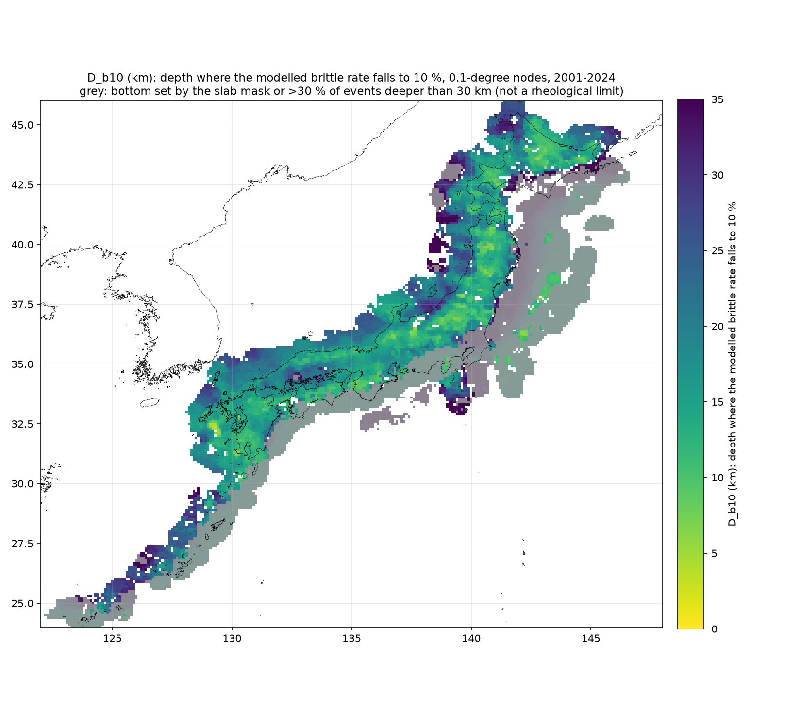

# Lower limit of brittle seismicity beneath the Japanese islands (based on JMA unified catalogue 2001-2024)

Maps of the depth at which ordinary (brittle) earthquakes die out beneath Japan, on 0.1-degree and
0.025-degree nodes, with the code that makes them. Instead of a percentile (D90) of the raw
catalogue, the depth distribution at every node is fitted with a soft-bottomed model by maximum
likelihood, and aftershock sequences are down-weighted so that one large sequence cannot dominate
a node.

The maps are an independent work by the author, made from the publicly available unified
hypocenter catalogue of the Japan Meteorological Agency (JMA). They are not a product of JMA or of
any other data provider, and have not been reviewed or endorsed by them.



## Files

| File | Content |
| --- | --- |
| `seismogenic_bottom_Japan_2001-2024_0p1deg.tif` | 19-band Float32 GeoTIFF, EPSG:4326, pixel-is-point on 0.1-degree nodes (122-148E, 24-46N), ZSTD; search radius 10-40 km |
| `seismogenic_bottom_Japan_2001-2024_0p025deg.tif` | **high-resolution version**: same bands on 0.025-degree nodes (about 2.8 x 2.3 km), search radius 3-40 km (adaptive); see "Spatial resolution" |
| `seismogenic_bottom_Japan_2001-2024_0p1deg_noweights.tif` | 0.1-degree fit without family weights (every event weight 1), for comparison |
| `maps/seismogenic_bottom_Db10.png`, `maps/seismogenic_bottom_zb.png` | single maps (0.1 deg); grey = nodes whose bottom is set by the slab mask or by a deep (> 30 km) population |
| `maps/seismogenic_bottom_overview.png` | diagnostic panels (0.1 deg) |
| `maps/seismogenic_bottom_0p025_*.png` | the same three figures for the 0.025-degree product |
| `reference_sites.md`, `reference_sites_0p025deg.md` | fitted values at 27 reference sites, both products |
| `resolution_study/` | how far the resolution can be pushed: `resolution_study.md` (tables), `resolution_limit_rmin.png` (data-limited resolution map), `splithalf_kyushu.png`, `splithalf_tohoku_kanto.png` (reproducibility of the fine map between two independent halves of the catalogue) |
| `scripts/` | processing chain (see "Reproducing the maps"); `08_*`, `09_*` and `run_hires.ps1` belong to the resolution study |
| `work_summary.txt` | processing log (event counts, declustering statistics, run times) |

### GeoTIFF bands

| Band | Name | Meaning |
| --- | --- | --- |
| 1 | `D_b10` | **primary product**: `z_b + 1.28 s_b`, depth where the modelled brittle rate has fallen to 10 % of its plateau (km). Model-based counterpart of D90 |
| 2 | `D_b10_clean` | `D_b10` only where `quality_flag == 0` |
| 3 | `quality_flag` | bit mask: 1 = within 3 km of the slab cut-off (bottom set by the mask, not by rheology); 2 = more than 30 % of the weight deeper than 30 km; 4 = `s_b` > 6 km (gradual decay, bottom ill-defined); 8 = ESS < 50 |
| 4 | `z_b` | centre of the lower transition (50 % level), km |
| 5 | `s_b` | 1-sigma width of the lower transition, km (includes hypocentre depth scatter) |
| 6 | `D_b90` | `z_b - 1.28 s_b`, top of the transition |
| 7 | `se_z_b` | standard error of `z_b`, km |
| 8 | `z_t` | centre of the shallow onset of seismicity, km |
| 9 | `s_t` | width of the shallow onset, km |
| 10 | `p_outlier` | fraction of the uniform outlier component (capped at 0.05) |
| 11 | `D90_weighted` | classic D90 of the same weighted sample |
| 12 | `D95_weighted` | classic D95 |
| 13 | `D10_weighted` | classic D10 |
| 14 | `ESS` | Kish effective sample size (independent families equivalent) |
| 15 | `n_events` | earthquakes used at the node |
| 16 | `radius_km` | adaptive search radius (km) |
| 17 | `slab_cut_km` | median depth above which events were accepted (slab top minus margin, floor 15 km) |
| 18 | `slab_top_km` | median slab-top depth under the node |
| 19 | `frac_below_30km` | weight fraction of events deeper than 30 km |

Depths are in km below sea level (positive down). Nodes are NaN where ESS < 30, `se_z_b` > 5 km, or
the fit is degenerate (`z_b` < 0 or > 55 km). 12,284 nodes carry values in the 0.1-degree file
(195,040 in the 0.025-degree file); about a third of them have flag bit 1 (mostly offshore
fore-arc and Kanto, where the accepted depth range is cut by the slab surface), so `D_b10_clean`
is the band to use for rheological interpretation.

Each band carries its name as the band description, so it can be read by name, for example in
Python:

```python
import rasterio

with rasterio.open("seismogenic_bottom_Japan_2001-2024_0p1deg.tif") as src:
    band = {name: i for i, name in enumerate(src.descriptions, start=1)}
    d_b10 = src.read(band["D_b10_clean"])   # km, NaN outside valid nodes
    row, col = src.index(131.08, 32.88)     # Aso caldera
    print(d_b10[row, col])
```

In QGIS the files open directly; the pixel-is-point georeferencing places each pixel centre on a
node.

## Input data

* JMA unified hypocenter catalogue, yearly files `h2001` to `h2024`,
  <https://www.data.jma.go.jp/eqev/data/bulletin/hypo.html> (96-byte fixed-width records).
  4,672,464 JMA hypocentres in total.
* Slab2 (Hayes et al. 2018, <https://doi.org/10.5066/F7PV6JNV>): slab-top depth and uncertainty
  grids of the `kur`, `izu`, `ryu` and `phi` models (`phi` has no events inside the map box).
* Plate-configuration contours of the Philippine Sea and Pacific slabs distributed by F. Hirose (MRI,
  `plate_data.tar.gz`, <https://www.mri-jma.go.jp/Dep/sei/fhirose/plate/en.PlateData.html>):
  Hirose et al. (2008a, 2008b), Nakajima & Hasegawa (2006, 2007), Nakajima et al. (2009), Kita et
  al. (2010), Baba et al. (2002). Slab2 is 15-25 km too deep beneath Kyushu, the Bungo Channel and
  Kanto; at every point the shallower of the two models is used.
* GSHHG shorelines (Wessel & Smith 1996, <https://www.soest.hawaii.edu/pwessel/gshhg/>),
  intermediate resolution, level 1: coastlines of the figures and the land mask of the resolution
  study only.

None of the input data are redistributed here.

## Processing chain

1. **Parse** (`01_parse_jma.py`): record type `J` only.
2. **Select upper-plate, well-located, ordinary earthquakes** (`02_filter_upper_plate.py`,
   `02b_hirose_surfaces.py`): hypocentre evaluation `1` (depth free), auxiliary information `1`
   (drops low-frequency events, eruption-related events and blasts), determination flag `K`, `k` or
   `A`, depth 0-60 km, depth s.e. <= 3 km, horizontal s.e. <= 5 km, and depth shallower than the slab
   top minus max(5 km, Slab2 uncertainty). A floor of 15 km keeps the shallow crust where the slab
   top is very shallow (trench toe, Izu collision zone). 2,428,185 events remain (median depth s.e.
   0.9 km, median M 0.7).
3. **Nearest-neighbour declustering** (`03_decluster_nn.py`, Zaliapin & Ben-Zion 2013):
   `eta = t[yr] * r[km]^1.6 * 10^(-m_parent)`; the threshold log10(eta0) = -5.35 is the equal-posterior
   point of a two-component Gaussian mixture fitted to log10(eta). 42 % of the events are clustered;
   they form 1,398,056 families (largest: Kumamoto 2016 with 88,826 events, the upper-plate part of
   the 2011 Tohoku sequence with 82,865, Noto 2024 with 80,860). Each family receives total weight 1
   (w = 1 / family size), so an aftershock sequence counts as one independent sample of the depth
   distribution while its depth information is still used.
4. **Node-wise maximum-likelihood fit** (`04_fit_seismogenic_bottom.py`): for every node, the
   earthquakes within an adaptive radius (the smallest of 10, 15, 20, 30, 40 km for the 0.1-degree
   product, of 3, 5, 7, 10, 15, 20, 30, 40 km for the 0.025-degree product, that gives ESS >= 30 and
   n >= 60) are binned in 0.25-km depth bins with their weights and fitted with

   ```text
   f(z) = (1 - p) * Phi((z - z_t)/s_t) * [1 - Phi((z - z_b)/s_b)] / norm  +  p / 60 km
   ```

   (Phi: standard normal CDF). The lower transition (z_b, s_b) is the target; the shallow onset
   (z_t, s_t) absorbs the near-surface deficit; the uniform component p (capped at 5 %) absorbs
   mislocated or residual slab events without being able to swallow a genuine deeper population.
   Nelder-Mead from three starting points; standard errors from the observed information in the
   (z_b, s_b) block. 13,131 nodes fitted in about 3 minutes on 20 cores (0.1 deg); 209,938 nodes in
   42 minutes on 22 cores (0.025 deg).
5. **Export** (`05_plot_maps.py`, `06_write_geotiff.py`, `07_poi_table.py`).

## Why not D90

D90 is a percentile of whatever happened to be recorded. A node that hosted a large aftershock
sequence reports the depth statistics of that sequence (which are also transiently deeper than
background seismicity, because post-seismic loading drives the transition zone to fail), while its
neighbours report background. The model-based estimate separates the position of the transition
(`z_b`) from its sharpness (`s_b`), is insensitive to a few deep outliers through the mixture
component, and uses family weights so that the map reflects long-term background seismicity.
`D90_weighted` is provided so that the two can be compared: over Japan `D_b10` exceeds `D90` by
1.4 km (median) because D90 cuts 10 % of the real distribution whereas `D_b10` sits where the
modelled rate has decayed to 10 %. Family weighting changes `D_b10` by more than 2 km at 546 nodes,
mainly around the 2016 Kumamoto, 2004 Chuetsu, 2008 Iwate-Miyagi and 2024 Noto sequences.

## Spatial resolution

The node spacing is not the resolution; the search radius is. The 0.025-degree product therefore
lets the radius shrink to 3 km where the data allow (3, 5, 7, 10, 15, 20, 30, 40 km, smallest with
ESS >= 30 and n >= 60) and stores the radius used in band 16. Three things limit how far this can
be pushed (details and tables in `resolution_study/resolution_study.md`):

1. **Data density** (`08_resolution_limits.py`, `resolution_limit_rmin.png`). With 2.43 million
   upper-plate events and family weights, the share of land nodes on Honshu, Kyushu and Shikoku
   (130-142E, 31-41.5N) that reach ESS >= 30 within a given radius is 15 % at 2 km, 27 % at 3 km,
   50 % at 5 km, 85 % at 10 km and 96 % at 15 km. In the 0.025-degree product 10 % of the valid
   nodes use 3 km, 32 % use < 10 km and the rest fall back to 10-40 km (where the result is
   identical to the 0.1-degree product). Offshore and in Hokkaido the limit is 20-40 km.
2. **Hypocentre location**. The horizontal standard error of the selected events is 0.44 km
   (median) and 1.2 km (90th percentile); the depth error 0.85 km (median). A radius below about
   2 km would average over a footprint comparable to the location scatter and gain nothing.
3. **Estimation noise** (split-half test: families were divided by parity of their id into two
   independent halves and the fit repeated on each). Between the halves `D_b10` differs by 0.9-1.1 km
   RMS at every fixed radius from 2 to 20 km (0.1-degree nodes), which implies a noise of about
   0.5 km RMS (0.25 km robust) for the full-data estimate, consistent with the Hessian standard
   error (median 0.3 km). The fine-scale texture of the map (deviation from a 0.5-degree running
   mean, RMS 2.1-2.6 km) is reproduced between the halves with a correlation of 0.85 (2 km) to 0.90
   (3-20 km), a texture signal-to-noise of 4-6. On the 0.025-degree grid the Kyushu and
   Tohoku-Kanto test regions (`splithalf_kyushu.png`, `splithalf_tohoku_kanto.png`) give a robust
   noise of 0.3 and 0.4 km and a correlation of 0.75 and 0.82 for the texture below 0.275 degrees.
   Noise is therefore not the limiting factor down to 2 km.

So the practical limit is data density: a 3-km radius (0.025-degree grid) is available for a
quarter of the main islands and a 5-km radius for half; a 2-km radius (0.02-degree grid) would
add resolution for another 15 % of the land area at the same noise level, and below 2 km the
location scatter takes over. Two caveats apply to reading the fine texture:

* Thermal structure cannot vary laterally at 2-5 km scales at 10-15 km depth (the diffusion
  length over 1 Myr is about 6 km); the fine texture records which faults, swarms and sequences
  are active and where fluids or intrusions sit (Aso 6.7 km and Izu-Tobu 5.1 km at 3 km radius
  versus 11-12 km at 10 km), not a change of rheology on that scale. The 0.1-degree product (or
  the fine product's 10-40 km nodes) is the rheological map; the fine product resolves its
  structure.
* The split-half test treats families as independent, but the nearest-neighbour declustering
  can fragment one physical sequence into several families, so part of the fine texture around
  large sequences is reproduced for physical, not statistical, reasons. The 0.1-degree
  `_noweights` comparison remains the check for sequence dominance.

## Caveats

* Depths are JMA routine (1-D velocity model) depths; offsets of 1-3 km relative to 3-D relocated
  catalogues are expected, and offshore depths are poorly constrained (mostly removed by the error
  criteria, but S-net-era offshore events since 2016 survive along the Tohoku and Hokkaido fore-arc).
* The slab mask depends on the plate models. Where the accepted range is cut by the slab surface
  (quality bit 1) the bottom is the mask, not rheology; where the models are too deep, slab events
  leak in and show up as a deep population (quality bit 2, e.g. Hidaka, eastern Hokkaido, northern
  Kanto) or as implausibly deep `D_b10` (Tsukuba 44 km).
* `s_b` is an apparent width: hypocentre scatter broadens it. Where the depth distribution decays
  gradually (volcanic swarm areas such as Hakone or Unzen, aftershock-rich areas such as Chuetsu),
  `z_b` is shallow and `s_b` large; `D_b10` is the quantity to read as the base.
* The catalogue is heterogeneous in time (automatic hypocentres since April 2016 add many M < 1
  events). Family weights reduce, but do not remove, the effect of local network density.

## Reproducing the maps

The scripts were run with Python 3.14 (NumPy 2.5, SciPy 1.18, pandas 3.0, numba 0.68,
scikit-learn 1.9, rasterio 1.5, matplotlib 3.11, GDAL 3.13 Python bindings) on Windows; nothing in
them is specific to Windows. Install the Python packages with `pip install -r requirements.txt`;
the GDAL bindings (`osgeo`) come with your GDAL installation or from conda-forge.

Put the inputs next to the scripts (any paths work; these are the ones used below):

```text
raw/h2001 ... raw/h2024     unzipped yearly files from the JMA hypocenter page
slab2/                      {kur,izu,ryu,phi}_slab2_dep_*.grd and {kur,izu,ryu,phi}_slab2_unc_*.grd
plate_data/                 extracted plate_data.tar.gz (folders sw, kanto, izu3, nakajima, baba, PAC)
GSHHS_i_L1.shp              GSHHG shapefile, intermediate resolution, level 1 (figures only)
work/                       intermediate .npz files (about 1.6 GB in total)
```

Then run, from the repository root:

```sh
# catalogue, slab mask, declustering
python scripts/01_parse_jma.py raw work/jma_2001_2024.npz 2001 2024
python scripts/02b_hirose_surfaces.py plate_data work/hirose_surfaces.npz
python scripts/02_filter_upper_plate.py work/jma_2001_2024.npz slab2 work/upper_plate.npz 3 5 work/hirose_surfaces.npz
python scripts/03_decluster_nn.py work/upper_plate.npz work/upper_plate_declustered.npz 1.0 1.6 auto

# 0.1-degree product, with and without family weights
python scripts/04_fit_seismogenic_bottom.py work/upper_plate_declustered.npz work/fit_v3_0p1.npz --step 0.1 --workers 20
python scripts/04_fit_seismogenic_bottom.py work/upper_plate_declustered.npz work/fit_v3_0p1_noweights.npz --step 0.1 --workers 20 --no-weights

# 0.025-degree product (also the first step of run_hires.ps1)
python scripts/04_fit_seismogenic_bottom.py work/upper_plate_declustered.npz work/fit_v3_0p025.npz --step 0.025 --workers 20 --radii 3,5,7,10,15,20,30,40

# GeoTIFFs, figures, reference-site tables
python scripts/06_write_geotiff.py work/fit_v3_0p1.npz seismogenic_bottom_Japan_2001-2024_0p1deg.tif
python scripts/06_write_geotiff.py work/fit_v3_0p1_noweights.npz seismogenic_bottom_Japan_2001-2024_0p1deg_noweights.tif
python scripts/06_write_geotiff.py work/fit_v3_0p025.npz seismogenic_bottom_Japan_2001-2024_0p025deg.tif
python scripts/05_plot_maps.py work/fit_v3_0p1.npz maps/seismogenic_bottom --coast GSHHS_i_L1.shp --compare work/fit_v3_0p1_noweights.npz
python scripts/05_plot_maps.py work/fit_v3_0p025.npz maps/seismogenic_bottom_0p025 --coast GSHHS_i_L1.shp
python scripts/07_poi_table.py work/fit_v3_0p1.npz reference_sites.md
python scripts/07_poi_table.py work/fit_v3_0p025.npz reference_sites_0p025deg.md

# resolution study
python scripts/08_resolution_limits.py work/upper_plate_declustered.npz work/resolution_limits_0p025.npz --coast GSHHS_i_L1.shp
pwsh scripts/run_hires.ps1 -Work work -Workers 20
python scripts/09_resolution_study.py work resolution_study --coast GSHHS_i_L1.shp
```

The declustering takes under a minute (numba, parallel), the 0.1-degree fit about 3 minutes on 20
cores, the 0.025-degree fit about 45 minutes, and `run_hires.ps1` about 75 minutes on 22 cores.
`work_summary.txt` is the log of the run that produced the published files.

## Licence

* Code (`scripts/`): MIT licence, see [LICENSE](LICENSE).
* Data products (the GeoTIFFs, `maps/`, `resolution_study/`, the reference-site tables): Creative
  Commons Attribution 4.0 International (CC BY 4.0), see [LICENSE-DATA](LICENSE-DATA).

## How to cite

Please cite this repository (see [CITATION.cff](CITATION.cff)) together with the input data:

Ikegami, F. (2026). Lower limit of brittle seismicity beneath the Japanese islands (based on JMA
unified catalogue 2001-2024). https://github.com/geoign/seismogenic_bottom_Japan

## Acknowledgements and references of the inputs

Source: Japan Meteorological Agency website (<https://www.data.jma.go.jp/eqev/data/bulletin/hypo.html>).
The maps were created by F. Ikegami based on the JMA unified hypocenter catalogue; the hypocentres
were selected, declustered and model-fitted by the author as described above.

The hypocentres are from the unified hypocenter catalogue of the Japan Meteorological Agency, which
JMA compiles from data of the National Research Institute for Earth Science and Disaster Resilience,
Hokkaido, Hirosaki, Tohoku, Tokyo, Nagoya, Kyoto, Kochi, Kyushu and Kagoshima Universities, the
National Institute of Advanced Industrial Science and Technology, the Geospatial Information
Authority of Japan, the Japan Agency for Marine-Earth Science and Technology, the Association for
the Development of Earthquake Prediction, Aomori Prefecture, the Tokyo Metropolitan Government,
Shizuoka Prefecture, the Hot Springs Research Institute of Kanagawa Prefecture and JMA, among
others (see the notes of the JMA seismological bulletin).

* Baba, T., Tanioka, Y., Cummins, P. R. & Uhira, K. (2002) The slip distribution of the 1946 Nankai
  earthquake estimated from tsunami inversion using a new plate model. Phys. Earth Planet. Inter.
  132, 59-73.
* Hayes, G. P. et al. (2018) Slab2, a comprehensive subduction zone geometry model. Science 362,
  58-61. Data release: https://doi.org/10.5066/F7PV6JNV
* Hirose, F., Nakajima, J. & Hasegawa, A. (2008a) Three-dimensional velocity structure and
  configuration of the Philippine Sea slab beneath Kanto district, central Japan, estimated by
  double-difference tomography. Zisin (J. Seismol. Soc. Jpn.) 2, 60, 123-138 (in Japanese with
  English abstract).
* Hirose, F., Nakajima, J. & Hasegawa, A. (2008b) Three-dimensional seismic velocity structure and
  configuration of the Philippine Sea slab in southwestern Japan estimated by double-difference
  tomography. J. Geophys. Res. 113, B09315, https://doi.org/10.1029/2007JB005274
* Kita, S., Okada, T., Hasegawa, A., Nakajima, J. & Matsuzawa, T. (2010) Anomalous deepening of a
  seismic belt in the upper-plane of the double seismic zone in the Pacific slab beneath the
  Hokkaido corner. Earth Planet. Sci. Lett. 290, 415-426.
* Nakajima, J. & Hasegawa, A. (2006) Anomalous low-velocity zone and linear alignment of seismicity
  along it in the subducted Pacific slab beneath Kanto, Japan. Geophys. Res. Lett. 33, L16309,
  https://doi.org/10.1029/2006GL026773
* Nakajima, J. & Hasegawa, A. (2007) Subduction of the Philippine Sea plate beneath southwestern
  Japan: slab geometry and its relationship to arc magmatism. J. Geophys. Res. 112, B08306,
  https://doi.org/10.1029/2006JB004770
* Nakajima, J., Hirose, F. & Hasegawa, A. (2009) Seismotectonics beneath the Tokyo metropolitan
  area, Japan: effect of slab-slab contact and overlap on seismicity. J. Geophys. Res. 114, B08309,
  https://doi.org/10.1029/2008JB006101
* Wessel, P. & Smith, W. H. F. (1996) A global, self-consistent, hierarchical, high-resolution
  shoreline database. J. Geophys. Res. 101, 8741-8743.
* Zaliapin, I. & Ben-Zion, Y. (2013) Earthquake clusters in southern California I: identification
  and stability. J. Geophys. Res. 118, 2847-2864.
